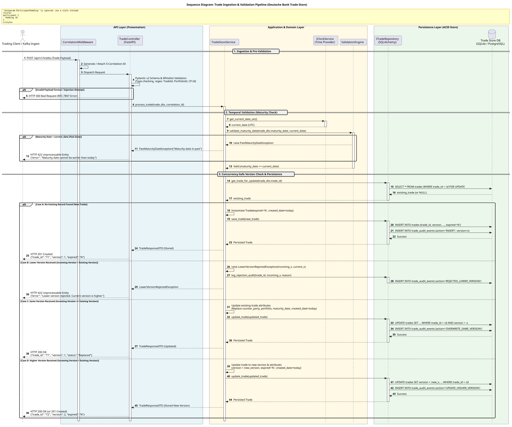
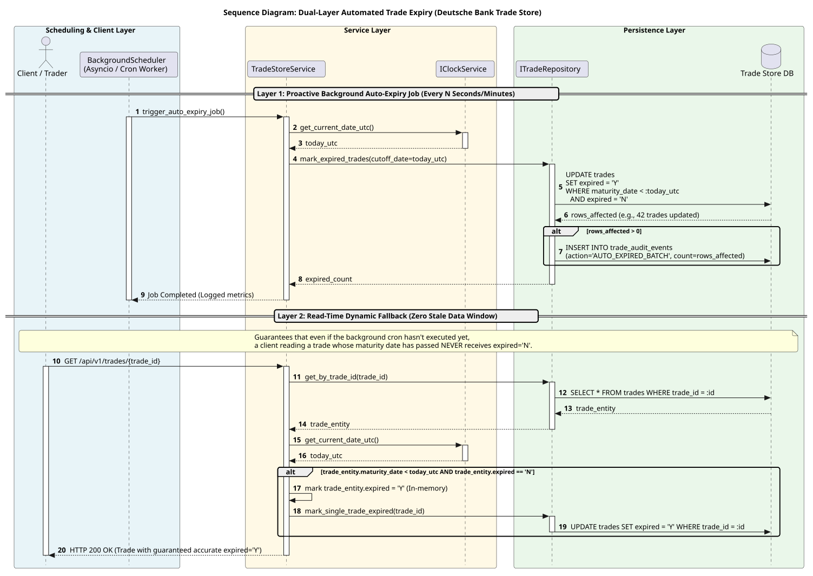
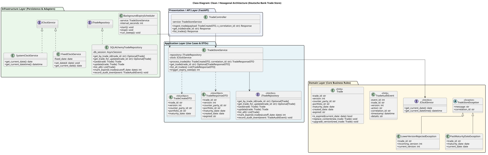
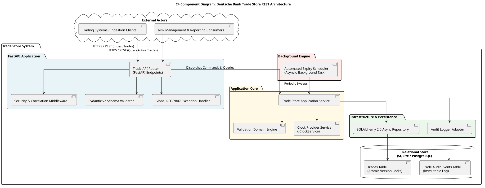

# Deutsche Bank Trade Store - Architecture & System Design Specification

## 1. Executive Summary
This document specifies the software architecture, domain design, data contracts, and security controls for the **Deutsche Bank Trade Store REST API**.

The application receives, validates, sequences, stores, and monitors financial trade transactions submitted concurrently across multiple desks and systems. It enforces strict temporal consistency, version ordering rules, automated lifecycle expiry, and immutable auditability compliant with financial regulations (**BCBS 239**, **MiFID II**, and **DORA**).

---

## 2. Domain Data Model & Entity Specifications

### Trade Entity Schema
| Field | Type | Constraint | Description |
| :--- | :--- | :--- | :--- |
| `trade_id` | `VARCHAR(32)` | `PRIMARY KEY`, Indexed | Unique identifier of the financial trade (e.g., `T1`, `T2`). |
| `version` | `INTEGER` | `NOT NULL`, Positive | Monotonically increasing version number for trade revisions. |
| `counter_party_id` | `VARCHAR(32)` | `NOT NULL` | Counterparty trading identifier (e.g., `CP-1`). |
| `portfolio_id` | `VARCHAR(32)` | `NOT NULL` | Trading book or portfolio code (e.g., `B1`). |
| `maturity_date` | `DATE` | `NOT NULL` | The contract maturity date (`YYYY-MM-DD`). |
| `created_date` | `DATE` | `NOT NULL` | Date when the trade version was accepted into the store. |
| `expired` | `CHAR(1)` | `'Y'` or `'N'`, Indexed | Lifecycle flag. Automatically transitions to `'Y'` when maturity date passes. |
| `updated_at` | `TIMESTAMP` | UTC `NOT NULL` | Audit timestamp of last update. |

### Immutable Audit Event Schema (`trade_audit_events`)
Banking compliance requires that replacing or rejecting a record does not erase history. Every ingestion attempt is immutably recorded:
| Field | Type | Description |
| :--- | :--- | :--- |
| `event_id` | `BIGINT AUTOINCREMENT` | Monotonic primary key. |
| `trade_id` | `VARCHAR(32)` | Target trade identifier. |
| `version` | `INTEGER` | Submitted trade version. |
| `action` | `VARCHAR(32)` | `INSERT`, `OVERWRITE_SAME_VERSION`, `UPDATE_HIGHER_VERSION`, `REJECTED_LOWER_VERSION`, `REJECTED_PAST_MATURITY`, `AUTO_EXPIRED`. |
| `correlation_id`| `VARCHAR(64)` | `X-Correlation-ID` tracing header. |
| `timestamp` | `TIMESTAMP` | UTC timestamp of event. |
| `details` | `TEXT` | JSON payload of changes or rejection reason. |

---

## 3. Business Validation Rules & State Transitions

### Rule 1: Trade Version Ordering
* **Lower Version Received ($V_{in} < V_{curr}$):**
  * **Action:** Rejection. Raise `LowerVersionRejectedException`.
  * **HTTP Response:** `422 Unprocessable Entity` (RFC-7807 error detail).
  * **Store Impact:** Existing stored trade remains untouched. Rejection event logged to audit table.
* **Same Version Received ($V_{in} == V_{curr}$):**
  * **Action:** Overwrite/Replace existing attributes (`counter_party_id`, `portfolio_id`, `maturity_date`, `created_date = today`).
  * **HTTP Response:** `200 OK`.
  * **Store Impact:** Record updated in-place; replacement logged to audit table.
* **Higher Version Received ($V_{in} > V_{curr}$):**
  * **Action:** Accept and update current record to new version.
  * **HTTP Response:** `200 OK` (or `201 Created` for first version).
  * **Store Impact:** Record updated; state logged to audit table.

### Rule 2: Maturity Date Validation
* **Condition:** $MaturityDate < CurrentDate_{UTC}$.
* **Action:** Rejection. Raise `PastMaturityDateException`.
* **HTTP Response:** `422 Unprocessable Entity` (`"Maturity date cannot be earlier than today"`).
* **Store Impact:** Trade is refused entry; rejected state logged to audit table.

### Rule 3: Automated Expiry Lifecycle
* **Condition:** When $CurrentDate_{UTC} > MaturityDate$, the store must automatically transition the trade's status to `expired = 'Y'`.
* **Dual-Layer Architecture:**
  1. **Layer 1 (Proactive Background Worker):** An asynchronous scheduler wakes up periodically (e.g., every 60s or at End-of-Day) and issues a bulk atomic database update:
     ```sql
     UPDATE trades
     SET expired = 'Y', updated_at = CURRENT_TIMESTAMP
     WHERE maturity_date < :today_utc AND expired = 'N';
     ```
  2. **Layer 2 (Read-Time Dynamic Fallback):** On `GET /trades` or `GET /trades/{id}`, the domain model checks if $MaturityDate < Today$. If so, it dynamically renders `expired = 'Y'` and queues an async write-behind to the database, guaranteeing **zero window of stale data**.

---

## 4. Concurrency & High-Throughput Strategy ("Thousands of Trades")

In trading environments with thousands of messages arriving per second:
1. **Row-Level Locking:** During trade processing, the repository acquires a database row-level lock:
   ```sql
   SELECT * FROM trades WHERE trade_id = :id FOR UPDATE;
   ```
2. **Conditional Atomic Upsert:** On databases supporting upsert semantics (PostgreSQL/SQLite), state transitions can be applied with SQL conditions:
   ```sql
   INSERT INTO trades (trade_id, version, counter_party_id, portfolio_id, maturity_date, created_date, expired)
   VALUES (:id, :v, :cp, :pf, :mat, :created, 'N')
   ON CONFLICT (trade_id) DO UPDATE
   SET version = EXCLUDED.version,
       counter_party_id = EXCLUDED.counter_party_id,
       portfolio_id = EXCLUDED.portfolio_id,
       maturity_date = EXCLUDED.maturity_date,
       created_date = EXCLUDED.created_date,
       expired = 'N'
   WHERE EXCLUDED.version >= trades.version;
   ```
   If zero rows are affected on conflict due to the `WHERE` clause, a concurrent process with a higher version won the race, and the lower version is cleanly rejected.
3. **Connection Pooling & Asynchronous I/O:** Built with async SQLAlchemy 2.0 and `asyncpg` / `aiosqlite` with tuned connection pool sizing.

---

## 5. Architectural Blueprints (PlantUML)

All diagrams are versioned in `docs/diagrams/` and visually rendered below:

### 5.1 Sequence: Ingestion & Validation Pipeline

*Source:* [`docs/diagrams/sequence_trade_ingestion.puml`](../diagrams/sequence_trade_ingestion.puml)

### 5.2 Sequence: Dual-Layer Automated Expiry

*Source:* [`docs/diagrams/sequence_auto_expiry.puml`](../diagrams/sequence_auto_expiry.puml)

### 5.3 Class Diagram: Clean Architecture & Domain Entities

*Source:* [`docs/diagrams/class_diagram.puml`](../diagrams/class_diagram.puml)

### 5.4 C4 Component Diagram: End-to-End System Components

*Source:* [`docs/diagrams/component_c4.puml`](../diagrams/component_c4.puml)

---

## 6. Banking Security & Compliance Defense-in-Depth

The deployment pipeline (`.github/workflows/ci.yml`) enforces institutional banking controls:
1. **Zero Hardcoded Credentials (Gitleaks):** All commits scanned for secrets, tokens, or private keys.
2. **Open-Source Software SCA (OpenSSF pip-audit + Aqua Trivy):**
   * Scans dependencies against NVD and GitHub Advisory databases.
   * **Hard Gate:** Fails the build with exit code `1` if any `CRITICAL` vulnerability is detected.
3. **Software Bill of Materials (SBOM):** Automated CycloneDX standard SBOM generated on every release build for DORA auditability.
4. **Static Application Security Testing (Semgrep + Bandit):** Automated AST scanning for OWASP Top 10 vulnerabilities (SQLi, ReDoS, Command Injection).
5. **Information Disclosure Prevention:** Global exception interceptor masks database traces and returns RFC-7807 compliant error bodies with `X-Correlation-ID`.

---

## 7. Technology Decisions & Rationale (ADR Summary)
* **Python 3.12+:** Leverages modern typing, performance enhancements, and structured concurrency.
* **FastAPI:** High-performance async ASGI framework with native OpenAPI / Swagger documentation (`/docs`).
* **Pydantic v2:** Rust-backed validation engine with millisecond parsing and strict regex constraints.
* **SQLAlchemy 2.0 (Async):** Type-safe ORM supporting both lightweight embedded storage (SQLite for zero-config local runs and CI) and enterprise PostgreSQL for production.
* **IClockService Interface:** Decouples time checks from system clock to allow 100% deterministic testing of future, current, and past maturity dates.
